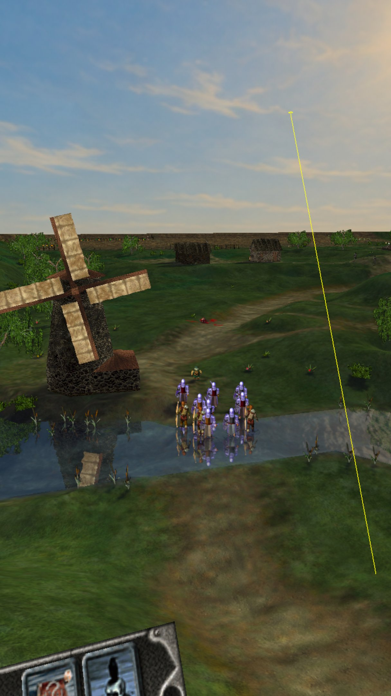
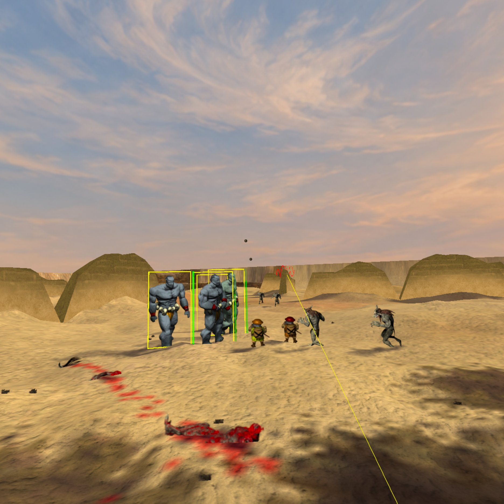
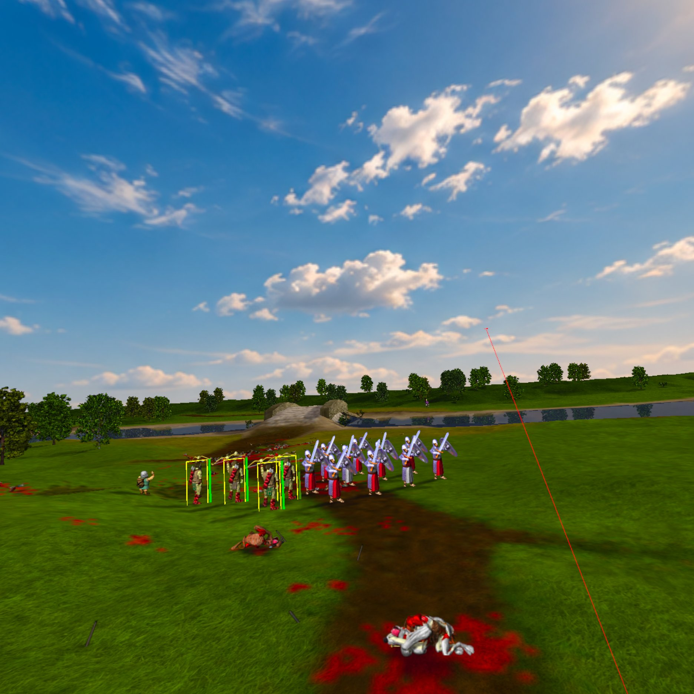
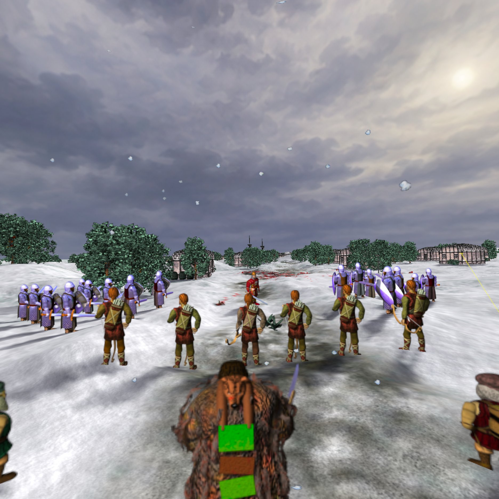
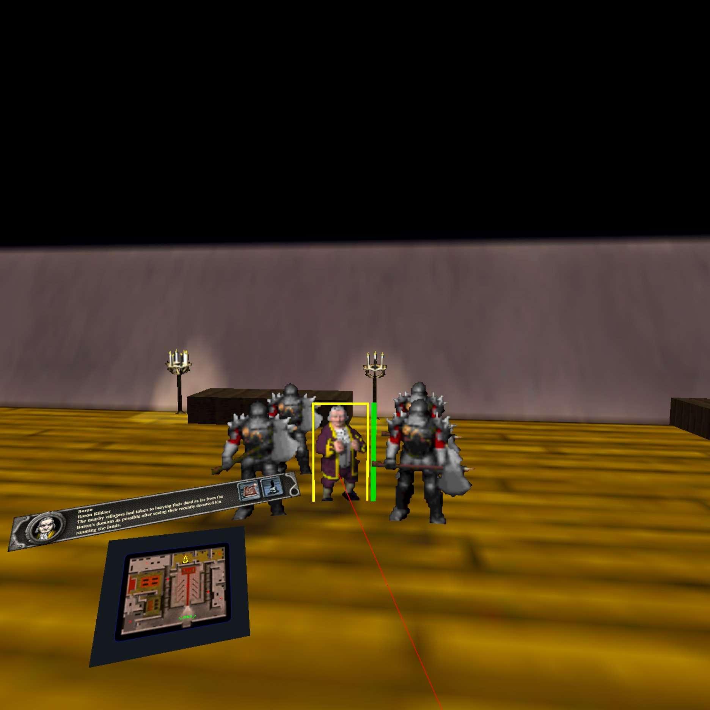
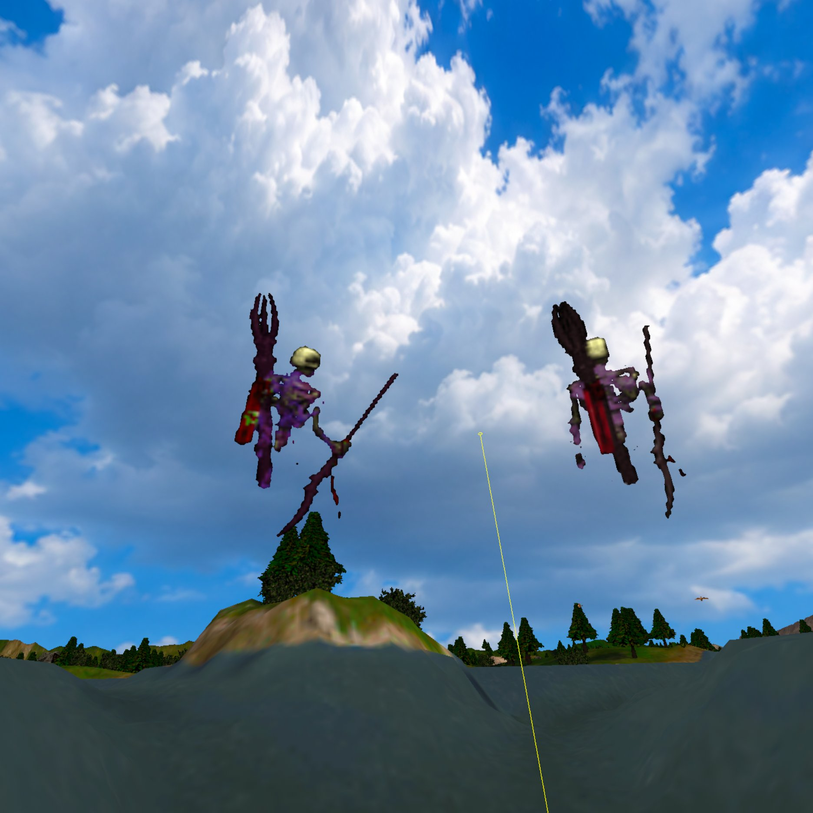

# Myth II for Meta Quest 3 / 3S

[English](README.md) | **日本語**

Myth II: SoulblighterをQuest 3 / 3Sで遊ぶための非公式VRフロントエンドです。没入空間の戦場に降り立ち、コントローラーで部隊を選択・操作できます。セットアップにはPCが必要ですが、プレイ時にはMeta Quest3/3Sの完全スタンドアローンです。

**APK・初回ランタイム・Plugin Managerは下のリンクからダウンロードして下さい。** セットアップには原作のISOと1.8.5アップデーターが必要です。

[ダウンロード](https://github.com/Snail921/Myth-II-for-Meta-Quest3-3S/releases/tag/v0.5.0-beta) · [導入手順](docs/INSTALL.ja.md) · [操作方法](docs/CONTROLS.ja.md)

  
  
  
  
  
  

## 遊ぶまでの流れ

1. **PCで準備する** — 自分のISO化したMyth IIの原作CDと1.8.5アップデーターを用意し、Plugin ManagerでVR用にデータを変換します。
2. **Questへ入れる** — APKをインストールし、USB接続してManagerから1で変換したVR用データを転送します。
4. **起動する** — Questのアプリライブラリ →「提供元不明」→ **「Myth II for Meta Quest 3 / 3S」** を開き、「初回データ展開」を一度実行し、展開が完了後に「原作を起動」を押します。
5. **遊ぶ** — 原作メニューでからゲームをスタート。レベルを開始するとVRに切り替わります。

必要なソフトと各画面の入力内容は、[導入手順](docs/INSTALL.ja.md)にまとめています。追加プラグインは別途ご用意ください。

Myth II 1.8.5パッチ、高精細マップテクスチャ・ハイレゾスプライト（Twice Born Edition）、The Fallen Levelsなどのプラグインは、[Project Magma](https://projectmagma.net/)から入手できます。

## 対応状況

| ゲーム | 確認状況 |
| --- | --- |
| Myth II: Soulblighter 1.8.5 | チュートリアル完了、Willow Creek等でプレイ確認済み |
| Chimera | 全8面のVR起動を確認済み |
| The Fallen Levels | 基本動作を確認済み。通しプレイは確認中。TFL GameplayはOFFで使用 |

すべてのプラグインに対応しているわけではありません。シンプルな構造で使用メモリが大きすぎなければ利用できると思います。

## 追加できるもの

- **キャンペーン：** Managerでプラグインを変換・転送します。
- **高精細画像：** 別途入手したHDアドオンをセットアップ時に指定します。
- **スカイボックス：** 配布ZIPを展開し、Managerでそのフォルダを指定します。フォーマットをそろえた自作のスカイボックスも利用可能です。

---

開発者向け：[ソースのビルド](docs/BUILD.ja.md) · [リリース内容](docs/RELEASE_STATUS.ja.md) · [ライセンス](THIRD_PARTY_NOTICES.md)

## 操作方法

[操作方法を開く](docs/CONTROLS.ja.md) — 選択・移動・グループ・Co-op割譲・ゲーム速度の操作をまとめています。

## 更新履歴

**0.5.0-beta** — マルチプレイチャット・両手キーボード・ミニマップへの書き込み、操作の入れ替え、描画最適化、色補正とBloom（初期OFF）。

**0.3.2-beta** — ハッシュ形式のノーマルパック。復元不要で転送でき、ファイル容量とVR読み込み時間を削減。

**0.2.0-beta** — 描画品質設定、Co-op割譲、方向指定・グループ操作の改善、影とスプライト表示の修正。

[すべての更新履歴](CHANGELOG.ja.md)

[描画設定・FPS](docs/GRAPHICS.ja.md) · [スプライト材質エディタ](docs/MATERIALS.ja.md)

[ノーマルマップ集（206コレクション）の導入](docs/NORMAL_LIBRARY.ja.md)

[キーボード・チャット](docs/KEYBOARD.ja.md)

## 技術情報

[VRフロントエンドの動作原理・構成図・最適化の記録](docs/TECHNICAL.ja.md) — 描画と原作の役割分担、最適化手法、検証結果、実プレイでの成果、計測上の注意点をまとめています。
