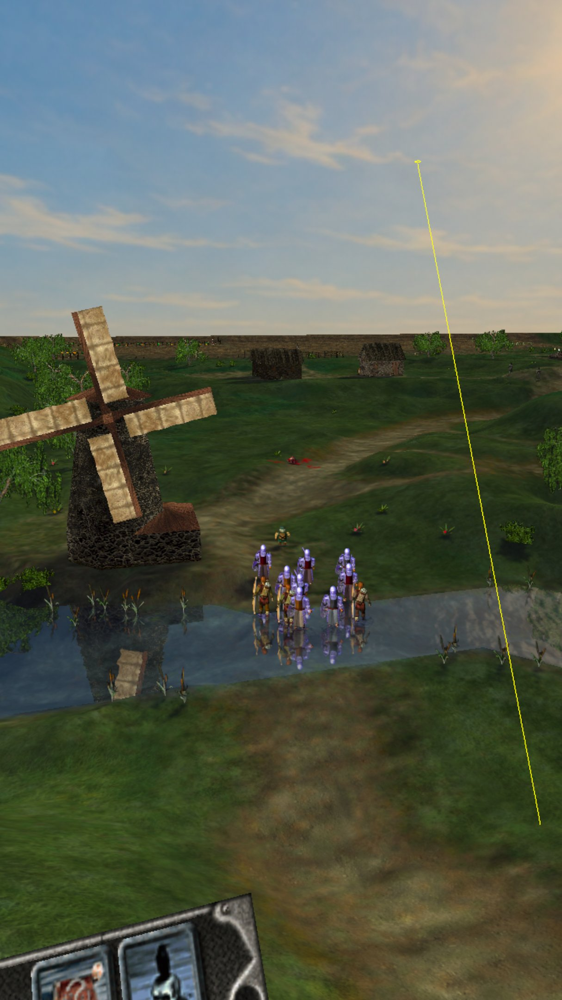

# Myth II for Meta Quest 3 / 3S

**English** | [日本語](README.ja.md)

An unofficial VR adaptation of **Myth II: Soulblighter** for Meta Quest 3 and Quest 3S. The original Windows game runs on the headset through a compatibility runtime; a native OpenXR renderer presents the battlefield in VR and sends controller commands to the original simulation. No gaming PC is required during play.

> **Publication status — 2026-11-16:** This release contains project source, the Windows Python Plugin Manager, optional artwork and 160 skyboxes. **The APK and initial runtime seed are not published yet**, pending verification of redistribution terms and corresponding source for the bundled runtime components. This is not a complete fresh-install download. See [release status](docs/RELEASE_STATUS.md).

[Downloads](https://github.com/Snail921/Myth-II-for-Meta-Quest3-3S/releases) · [Installation manual](docs/INSTALL.md) · [Build notes](docs/BUILD.md) · [Licenses and credits](THIRD_PARTY_NOTICES.md) · [Screenshot gallery](docs/GALLERY.md)

## Features

- Stereoscopic battlefield rendering, tracked controllers, unit selection, orders, formations and control groups.
- Wrist information panel and minimap; original objectives, narration and scripted camera synchronization.
- Water reflections, animated waves, fog, rain, snow and combat effects.
- External level packs and per-level skyboxes, without rebuilding the APK.
- Optional detail textures, high-resolution sprites/model surface images and detailed shadows from separately obtained addons.
- English/Japanese launcher and Plugin Manager UI.

## What has been checked

A fresh Quest 3 installation and Willow Creek gameplay were verified with the external-data development APK. Chimera's eight levels were checked for VR entry. The Fallen Levels was installed and basic rendering/input/FPS checked; campaign playthrough testing is ongoing. These checks do not guarantee every third-party plugin works.

Use the supported **Myth II 1.8.5** executable/data. **The Fallen Levels: keep TFL Gameplay OFF** (normal Myth II rules). Multiple gameplay-plugin combinations and Unity/TFL Gameplay are not supported. Very large packs can exceed memory/pack limits; Mazzarin's Demise VI is not a supported target at present.

## Start here

1. Read the [installation manual](docs/INSTALL.md) and [release limitations](docs/RELEASE_STATUS.md).
2. Prepare your own Myth II CD ISO and supported 1.8.5 updater. Game files and community plugins are **not** included.
3. On Windows, use Python 3.11 with Tkinter, Pillow, 7-Zip and Android Platform Tools. The manager is supplied as Python source, **not a standalone EXE**.
4. Run `python -m pip install -r requirements-manager.txt`, then open `Plugin Manager.cmd`.
5. Convert your own data on the PC. Deployment requires an installed compatible APK and its matching runtime seed; those downloads remain pending.

For an existing working installation, the manager can inspect, convert and deploy a separately acquired supported plugin. See [plugin installation](docs/INSTALL.md#install-a-plugin).

## Repository contents

| Path | Contents |
| --- | --- |
| `src/` | Native renderer, Android launcher, bridge and input code; base sources plus 1.8.5 adaptation |
| `tools/` | Plugin Manager, conversion tools, development build scripts and tests |
| `research/references/mythextract/` | Pinned MIT-licensed parser source and notice |
| `Assets/` | Optional Logo/CD images supplied by Snail921, plus project UI marker |
| `Skyboxes/` | 160 generated 2:1 panoramas and sanitized per-level metadata |
| `docs/` | English/Japanese manuals, build limitations and screenshots |

## Credits and rights

Unofficial community project; not affiliated with or endorsed by Bungie, Project Magma, Meta or the Winlator developers. Myth II and related game art/names belong to their respective rightsholders. Screenshots illustrate gameplay and are not a distribution of game data. Optional artwork is supplied by Snail921; see [asset terms](Assets/README.md). Project code and third-party code have separate notices; **the entire application is not simply “MIT”**. See [third-party notices](THIRD_PARTY_NOTICES.md).
