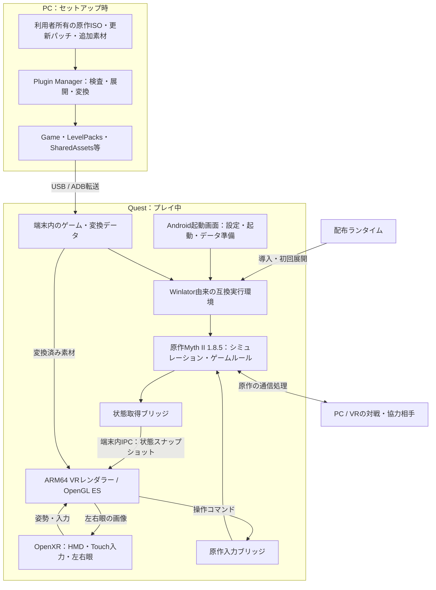

# 技術情報

[English](TECHNICAL.md) | **日本語** · [README](../README.ja.md) · [ビルド手順](BUILD.ja.md)

対象：0.5.0-betaの実装。記録整理日：2026-11-21。これは設計・検証の記録であり、すべての場面で同じ性能を保証するものではありません。

[疑似PBR版の描画とLOD](#pbr-preview)

## 動作原理と構成

本プロジェクトは、原作Myth II 1.8.5をQuest内で動かし、そのゲーム状態を独自のVRレンダラーで描画するフロントエンドです。原作の映像を平面スクリーンへ映すだけの方式ではなく、地形・モデル・スプライトなどを左右の眼の視点から描画します。ゲームルール、ユニットの挙動、進行、原作のマルチプレイ処理などは原作側が担当します。

Windows版原作の実行にはWinlator由来の実行環境（Wine・Box64等）を利用します。VR描画はAndroidネイティブのARM64コードで行い、OpenXRでHMD・コントローラー・左右眼の表示を扱い、OpenGL ESで描画します。PCはデータ変換・導入時に使います。プレイ中のゲーム実行とVR描画はどちらもQuest内で完結します。

図の通信相手は他の端末です。Quest内のブリッジ通信と、原作のマルチプレイ通信は別の経路です。

| 構成要素 | 主な役割 | 実装入口 |
| --- | --- | --- |
| PC側Manager | 利用者所有のデータを検査し、原作実行用データとVR用素材を準備・転送 | [plugin_manager.py](../tools/plugin_manager.py)、[base_setup.py](../tools/base_setup.py) |
| Android起動画面 | 設定、ランタイム準備、原作起動、レベル素材の準備 | [src/standalone](../src/standalone)、[src/standalone185](../src/standalone185) |
| 原作実行環境 | Windows版原作をQuest上で動かす | [ビルド構成](BUILD.ja.md)、[第三者ライセンス](../THIRD_PARTY_NOTICES.md) |
| 状態取得・入力ブリッジ | 原作のオブジェクト・アニメーション・エフェクト・UI等を取得し、VR操作を原作へ戻す | [src/bridge](../src/bridge)、[src/input](../src/input) |
| VRレンダラー | 素材とライブ状態を組み合わせ、左右眼のシーン、反射、UIを描画 | [main.cpp](../src/vr/main.cpp)、[src/vr](../src/vr) |

状態取得経路は、ループバックTCPとインストールごとの認証トークンを使用します。スナップショットにはバージョン・件数・サイズの検査があります。原作側の更新とHMDの描画周期は同一ではなく、VR側は受信した状態と現在の視点を使います。新しいVR表示機能を加えても、原作のゲーム処理そのものを置き換える構成にはしていません。

原作メニューやロビーなどには互換画面を使い、レベル開始時にVR表示へ移行します。静的な素材の変換はPC側で行い、プレイ中は位置・フレーム・パレット・地表変化などのライブ状態を反映します。原作データや第三者プラグインを、このプロジェクト独自のライセンスで再許諾するものではありません。

## 最適化の考え方

優先するのは、同じ結果を得るための重複作業・描画命令・メモリ転送を減らすことです。見た目を変える解像度低下や距離LODは、画質と性能を選ぶ設定として区別します。CPU時間、GPU時間、フレームレート、描画範囲数、参照回数の見積もりは別の指標です。

| 対象 | 実装済みの手法 | 主な狙い・注意点 |
| --- | --- | --- |
| スプライト | 実行時アトラス・材質単位のまとめ描画 | テクスチャ切替と描画命令を削減。追加GPUメモリを使う |
| 左右眼 | 不透明スプライトの両眼可視集合を共有し、準備・アップロードを再利用 | CPU処理・転送を削減。片眼だけに必要な端の描画はGPUでクリップ |
| パーティクル | 連続頂点ストリーム・バッファリング・視野判定・頂点単位の透明度 | 順序と透明度を維持し、隣接する互換描画だけを統合 |
| 反射 | 水面ごとの両眼キャッシュ、さらに通常ビルボードの共通準備を水面間で共有 | CPUのフレーム選択・形状準備を削減。飛翔物は個別処理 |
| 水面 | 空間区画、ステンシル、非同期の可視性問い合わせ | 不要な反射計算・描画を削減。GPU結果をその場で待たない |
| 地形 | 背面カリング・眼ごとの区画視野判定・連続描画範囲の統合 | 不可視の形状処理を削減。一般的な地形遮蔽判定ではない |
| 地形の詳細模様 | 同一材質IDと重みを地形データ生成時に集約 | 重複テクスチャ参照を抑える。材質境界を維持 |
| 影・照明 | 距離／表示サイズLOD、影参照の省略、光源の影響範囲判定 | シェーダー負荷を調整。LODは品質との交換条件 |
| 色補正 | 既存シェーダーへ組み込み、OFF時は元のソースを使用 | 全画面パスと輝度解析を追加しない |
| Bloom | 低解像度抽出・分離ぼかし・眼間の一時画像再利用、OFF/強度0で迂回 | 効果の負荷を抑える。全解像度コピー・合成は残る |

## スプライトとアトラス

[sprite_atlas.h](../src/vr/sprite_atlas.h)、[sprite_cache.h](../src/vr/sprite_cache.h)、[sprite_stream.h](../src/vr/sprite_stream.h)

- 現行ページは2048×2048 RGBA8。色とノーマルは別配置で、通常画像とHD画像の色ページも分けます。2ピクセルの複製境界で隣の画像の混入を抑えます。
- ノーマル画像は色ページごとに複製せず、同じ不変の元GLテクスチャをレベル内で共有します。初期の「色ページに対応したノーマルページ」方式は容量超過につながったため廃止しました。
- 上限768 MiBはアトラスの追加容量だけです。元テクスチャ、眼バッファなどは別途必要です。ページは必要時に確保し、容量不足や大きすぎる画像は元テクスチャへフォールバックします。
- 通常の不透明スプライトは両眼の可視集合の和を使い、2眼目でストリームを再利用します。頂点への参照を並べ替えて最後のストリームへ一度だけコピーし、中間配列と繰り返し確保を減らします。反射は眼ごとの水面範囲判定を維持します。

**検証記録：** Willow Creekの全4,282画像・35コレクションを登録した合成試験では、512pxページ時の46ページ／46範囲／52 MiBから、2Kページで4ページ／4範囲／64 MiBとなり、フォールバックは0でした。HD・ノーマルを含まない容量／集約試験であり、同時に見える画像数やゲーム中の描画回数ではありません。大きいページは切替を減らす一方、空き領域と確保単位を増やします。

Quest GPU比較では、アトラスと元描画の最大チャンネル差は1/255。両眼共有と独立した眼ごとのアップロードの比較では画素一致を確認しています。検証入口：[test_sprite_atlas_gpu.cpp](../tools/test_sprite_atlas_gpu.cpp)。これらからFPS改善率は算出していません。

## 滝・パーティクル・反射

[particle_stream.h](../src/vr/particle_stream.h)、[water_visibility.h](../src/vr/water_visibility.h)

Beyond Cloudspineの2026-11-20の問題記録には33 FPS、GPU使用率99%、通常エフェクトCPU約4.728 ms/frame、反射エフェクト約4.658 ms/frame、各パス約280～300描画がありました。地形GPU負荷も増えており、粒子だけが原因ではありません。

粒子ごとに異なるフェード透明度がバッチを分割していたため、透明度を頂点属性へ移しました。描画順は変えず、テクスチャ・所有者・解決後の材質が一致する隣接範囲を統合します。透明度の量子化や粒子数の削減はしません。追加ストリームは頂点あたり16バイト、ビルボードあたり96バイトです。通常／反射のGPU比較で画素一致を確認しました。

反射準備の調査では19報告区間でCPU平均2.269 ms/frame（1.396～2.644）。これは削減対象全体の測定値であり、削減できた時間ではありません。通常ビルボードのフレーム・HD画像・形状準備を水面間で共有し、水面ごとの高さクリップと視野判定は残しました。直接視野の可視集合を反射に流用すると、反射だけに見える物体が欠落するため、共有候補は直接視野に限定しません。軸方向ビルボードの飛翔物は水面ごとに計算します。

水面の可視性問い合わせは完了済み結果だけを読みます。見えるようになってから反射が復帰するまで1フレーム以上遅れる場合があります。画面内水面のステンシルによる制限と、水面区画による投影候補の削減も行います。

**実プレイの成果：** 利用者から粒子集約後に「一定の改善」、反射共通準備と地形視野判定後に「多少の改善」の報告がありました。同一視点・同一設定の前後測定が揃っていないため、改善率は未確定です。古い別記録の7～16 FPSと後の約72 FPSも、可視粒子数・視点が一致しないため直接比較しません。

詳細：[粒子の透明度と集約](../research/reports/particle-alpha-batching.md)、[地形・反射の調査と実装追記](../research/reports/terrain-reflection-optimization-review.md)。

## 地形とシェーダー

[detail_materials.h](../src/vr/detail_materials.h)、[detail_terrain.h](../src/vr/detail_terrain.h)、[color_pipeline.h](../src/vr/color_pipeline.h)

通常地形は眼ごとに保守的な視錐台判定を行い、残った連続頂点範囲だけをまとめます。背面カリングは反射時の反転した向きも考慮します。画面外形状の処理削減が目的であり、見えている地形のピクセルシェーディング負荷が同じ割合で減るわけではありません。調査時の通常地形GPU平均2.933 ms/callは眼／パス単位のサンプルで、CPUのms/frameと足し合わせられません。

地形詳細材質は三角形ごとの最大3材質を補間します。同じIDが複数ある場合、CPUでIDと重みを集約して未使用スロットを0にします。重みの小さい成分を切り捨てたり、材質0との境界を再正規化したりしません。明示的なテクスチャ勾配、ミップ選択、模様の倍率、フォグを維持します。

| ローカルBeyond the Cloudspineパックの解析 | 結果 |
| --- | ---: |
| 三角形数 | 99,458 |
| 正の材質IDが1種類 | 77,737（78.16%） |
| 2種類 / 3種類 | 21,484 / 237 |
| 三角形数で重み付けした参照機会 | 298,374 → 121,416（約59.3%減） |
| 平均参照機会 | 3 → 約1.221 |

これは画面のピクセル面積を考慮していない静的解析です。GPUの実参照数や「59.3%高速化」を示しません。QuestでCPU補間比較14,784ケース、実シェーダーのGPU画像比較768ケースを実施し、観測した最大バイト差は0でした。ゲーム中のFPS改善幅は未測定です。[調査・実装・検証記録](../research/reports/terrain-shader-optimization-review.md)

任意の詳細模様LODは距離20～40で薄め、40以遠で詳細参照を省きます。元の地表色・影は保持しますが見た目を変える設定です。一方、地形専用の完全不透明シェーダー化や深度プリパスは調査候補であり、実装済みの成果には数えません。

## 色補正とBloomから得た知見

色補正は表示符号化された色に `mix(c, clamp(c * (255 / 199), 0, 1), strength)` を適用します。フォグ合成と既存のsRGBデコード・追加照明より前に置き、空とUIを除外します。反射には一度だけ適用します。OFFでは元と同一のシェーダーソースを返し、ONでも全画面パス・追加テクスチャ参照・ヒストグラム解析はありません。ただしONの実ゲームでの追加時間は未測定で、「無料」とは断定しません。[色補正記録](../research/reports/scene-color-correction.md)

BloomはUIより前の眼画像を全解像度でコピー／MSAA解決し、低解像度で明部を抽出、水平・垂直の分離ぼかし、元画像へ加算します。空だけの画素を発光源から除外します。反射専用のBloomパスはなく、眼画像に含まれる反射の明部は発光し得ます。一時画像は左右眼で順に再利用します。

- 初期OFF。強度0も処理を迂回。解像度は各辺1/32～1/2、反復1～4回、強度0～200%。初期設定値は1/8・1回・15%。
- 低解像度にしても全解像度のコピーと合成は残ります。強度が正の範囲では、強度を増やしてもパス数は増えません。
- 合成試験の1536×1536・SRGB・MSAAなしでは、1/8・1回で0.503 ms/eye pass、1/2・4回で1.117 ms/eye pass。12パスのCPU壁時計時間で、元画像描画とglFinishを含み、ゲームのGPU工程時間ではありません。
- 利用者は、最低のシーン描画解像度＋Bloom 1/8の軽いシーンで90 FPSを確認。滝や他設定を含めた一般的な性能保証ではありません。
- 全解像度選択肢、RGBA/SRGB、MSAA有無、左右眼の残像防止、GL状態復元、OFF時の未確保をGPUテストで確認しています。

詳細：[Bloom設計・検証記録](../research/reports/bloom.md)。この記録には過去の強度上限400%の試行も残っていますが、現行上限は200%です。

## 計測方法と今後の記録

同じフィルム／ゲーム状態、固定視点、同じ解像度・Hz・MSAA・HD素材・影・照明・反射設定で、一度に一つの変更を比較します。アトラス初回登録とウォームアップ後を分け、端末の温度・電力状態、計測時間、ビルド／コミットも記録します。Hz上限に張り付いたFPSだけでは余力の改善が見えないので、CPU/GPU工程時間も確認します。

| ログ | 読み方 |
| --- | --- |
| Particle stages：legacy_draws / draws | 同じ入力に対する旧透明度分割と実際の集約の比較 |
| Sprite stereo：shared_upload_reuses | 左右眼のアップロード再利用回数 |
| Sprite atlas / atlas-high-water.tsv | ページ・追加容量・フォールバック。範囲集計はFPSではない |
| Reflection geometry：shared_builds / shared_reuses | 水面間の形状準備共有 |
| Terrain view：chunks / draw_calls | 可視区画と実際の描画範囲 |
| Terrain detail compact | CPU算出の参照機会。GPUハードウェア計測ではない |
| 工程CPU/GPU id=14 | Bloom。CPU ms/frameとGPUの眼／パス単位を区別する |

追記時は「問題・仮説 → 実装 → 比較条件 → 数値と単位 → 画質検証 → 制約／次の課題」を残します。体感報告、合成試験、同条件A/B測定を区別してください。研究メモの初期案より、後段の実装追記と現在のコードを優先します。

設計経緯：[両眼共有とノーマル画像共有への修正](../research/reports/stereo-stream-paired-atlas.md)、[2Kページと容量上限の試行](../research/reports/atlas-2k-pages.md)、[地形オプションと初期調査](../research/reports/terrain-options-and-sprite-reuse.md)。過去の256 MiB上限などは当時の条件です。

## スプライト材質パック：実装記録（開発版、2026-11-21）

Editorの出力は`MVRMAT03`（`.mvrnm`）で、元画像SHA-256による照合と寸法・64 MiB制限を維持します。RGBA8の各ピクセルに法線XY、Thickness、共通Metallic/Smoothnessを格納します。法線Zは正として復元し、Thickness用の別テクスチャ参照は行いません。旧V1/V2パックのアルファは従来どおりノーマルの有効領域として扱い、同じ元画像にはV3を優先します。HDの切り抜き・反転でも形式フラグを維持します。

動的アトラスは4チャンネルをそのままコピーし、端のピクセルを余白に複製します。新材質と旧ノーマルは別ページグループに分け、バッチの比較キーにも形式を含めます。カラー用ページは共有できます。両形式がある場合、既存のアトラス予算内で2048² RGBA8の材質ページ（16 MiB）が追加される可能性があります。

太陽方向は影生成と同じ「表面から光源へ」のベクトルを使用し、空の描画と同じ正距円筒・Yaw変換で画像の位置を決めます。左右を循環、上下をクランプした近傍3×3ピクセルをCPUで平均し、色だけでなく明るさも保持した**リニアRGB光量**として使います。毎ピクセル・毎眼ではなく、空や光源方向が変化したときに更新します。太陽角の調整時に再計算できるよう、デコード後のRGB空画像を保持します（4096×2048で最大24 MiB、空の入れ替え・VR終了時に解放）。空がない場合は追加効果を無効にします。

Blinn型のハイライトに共通M&Sの色応答と指数を使用します。透過は`(1 - Thickness) * (1 - M&S)`と逆光成分から求め、強化影の受け影可視率で減衰します。逆光を消してしまう自己陰影は透過に掛けません。映り込みは既存の空テクスチャを粗さに応じた明示的なミップで参照し、`M&S * 最大映り込み`でブレンドします。軽量な見た目の近似であり、ミップはBRDFで事前積分した環境マップではなく、元画像にも描き込みの照明が含まれます。厚み形状やHDRの太陽光を復元するものでもありません。追加効果にはフォグを適用します。強度3項目がすべて0ならPBR経路をコンパイル時に除外し、旧ノーマルのみの描画でも効果を迂回します。

Quest実機で影・光源・PBR・アトラス・色補正の32構成のコンパイルと、従来のアルファ／反射描画テストを通過。合成画像の画素比較では、スペキュラ増加、Thickness=1で透過なし／0で透過あり、金属のSSS抑制、映り込みブレンド、受け影による抑制、旧材質の不変性を確認しました。実行時テストは元画像ハッシュ照合、不完全パックの拒否、V3優先、アトラスの形式分離・余白のチャンネル保持、空の継ぎ目・Yaw・リセットを検証します。Pythonテストでは材質付き出力とライブラリの変換・復元を検証しています。**ゲームプレイ時のFPSや追加負荷は未計測です。**

実装：`src/vr/sprite_pbr.h`、`sprite_material.h`、`sprite_atlas.h`、`color_pipeline.h`。検証：`tools/test_scene_shader_variants_gpu.cpp`、`test_sprite_material_pipeline.h`。

迂回処理は描画バッチごとに別シェーダーを選び、通常側にはPBR関数・呼び出し・専用uniformを含めません。材質チャンネルの有効条件はテクスチャ転送時に一度集計し、アトラスのBindingとバッチキーへ引き継ぎます。共通uniformは各眼・反射パスで、使用するシェーダーごとに初回だけ準備します。パーティクルの描画順は変えません。`tools/test_sprite_pbr_routing_gpu.cpp`は実際のSpriteStream／ParticleStreamと切替コードをQuestで実行し、新旧材質の混在、アトラス有無、強度0、空なし、半透明合成・反射を検証します。

起動画面のスリープ診断：アプリの外部ファイル領域の `launcher-lifecycle.log` に、生成／再生成、開始／再開、停止、破棄、状態保存、ウィンドウフォーカス、メモリ警告を、PID・時刻・稼働時間・画面操作可能状態とともに記録します。VR詳細ログOFFでも記録し、128 KiBを超えると1世代の過去ログへ切り替えます。Androidのプロセス終了履歴と照合し、プロセス終了とウィンドウ復帰問題を切り分けます。長時間スリープ後に画面が消える問題の修正ではなく、原因調査用の記録です。

## 疑似PBR版の描画とLOD

MVRMAT05は画像単位にPBRフラグを持つ。対応画像のRGBAには法線XY、Thickness、M1S7の順に格納し、シェーダーで正方向の法線Zを復元する。カラー画像のアルファは元の輪郭に使用する。アトラス化後も材質形式と各画像のUV範囲を保持する。

通常描画・水面反射とも両眼の中心を基準に判定する。初期値では20 mから24 mまでSSS・スペキュラー・空の映り込みを同じ描画内で減衰させる。全体が遠いスプライトバッチは非PBRへ切り替え、距離が混在するバッチは遠方の寄与を個別に省く。強化影ONの対応メッシュは、遠方でも面法線と太陽方向で簡易セルフシャドウを計算して影の段差を抑える。メッシュだけ距離LODから除外できる。これらは描画経路の説明で、シーン別のFPS改善量は未測定。

## 反射の準備処理とカリング（Preview 3、2026-11-24）

現在の画像・方向と読み込み済みHD画像の境界を使い、重い形状準備より前に保守的な粗いカリングを行います。通常・反射パスで共有可能な準備をフレーム内で共有し、軸付き形状の向きは各パスで維持します。フレーム内の空間インデックスで反射候補を選び、水面・左右眼の和集合について形状・アトラス準備を共有し、パス別のインデックスバッファを使います。カメラ平面をまたぐ境界の保守的な扱いと、候補不足時の再構築により、開発中に発生したフィルム再生クラッシュを修正しました。

反射スプライトLODは水面・眼別の変換とスプライト距離をキャッシュし、水面範囲の候補選別後に投影します。判定は眼・パス間で再利用し、表示継続が確定した時点で投影を打ち切ります。スプライトがないパスではスプライトプログラム設定を省略しますが、他の反射要素は描画します。地形の形状LODを新規追加したものではありません。

ログには粗いカリングの判定・除外件数、準備の再利用、反射形状共有、Reflection sprite LOD（判定・近距離保持・除外・空パス・CPU時間）、Reflection LOD work（投影眼数・頂点数・早期保持）を記録します。水面・眼を合算した件数は、固有オブジェクト数や描画API呼び出し数とは異なります。CPU区間の経過時間はドライバ待ちを含み得るため、純粋なCPU実行時間やGPUタイマー値と同一視できません。

Questで総当たりとの候補一致、カメラ平面の回帰検証、粗い判定・準備の144比較、共有描画の112比較、左右眼LOD・ヒステリシス・設定範囲、最適化前後28,672判定の一致を確認しました。最終フィルム計測では致命的クラッシュ・和集合修復イベントはありませんでした。視点1・フィルムtick 600～1300、各設定1回・23サンプルの比較では、32 pxにより反射スプライトの選択件数が約2,317から564件/フレームへ減少し、反射CPU時間は9.99から9.46 ms/フレーム、FPSは51.19から52.63となりました。特定シーンの観測値であり、一般的な性能保証や32 pxの画質承認ではありません。既定値は2 pxのままです。既存の地形・PBRシェーダーLODとは別の変更です。

## Preview 4 — ユニファイド影とnoShadow（2026-11-28）

地形・建物・スプライトのユニファイド影、静的影キャッシュ、8Kまでの動的影解像度を追加。地面基本色の書き出し／読込、地形法線の補間、メッシュの共通シェーダー設定の共有を実装しました。元画像／影除去版の別プロジェクト、未編集HDより影除去アルベドを優先する経路、画像ごとのノーマル反転、終了時の復元保存エラー修正を含みます。独立したnoShadowパック（10コレクション／97画像）、APK、Manager／ソースZIPを公開。従来の通常／PBRパック、ランタイム、スカイボックスは継続利用できます。描画負荷および最適化不足によりFPSは50～60前後が目安で、保証値ではありません。[noShadowの導入と検証範囲](NOSHADOW.ja.md)。
