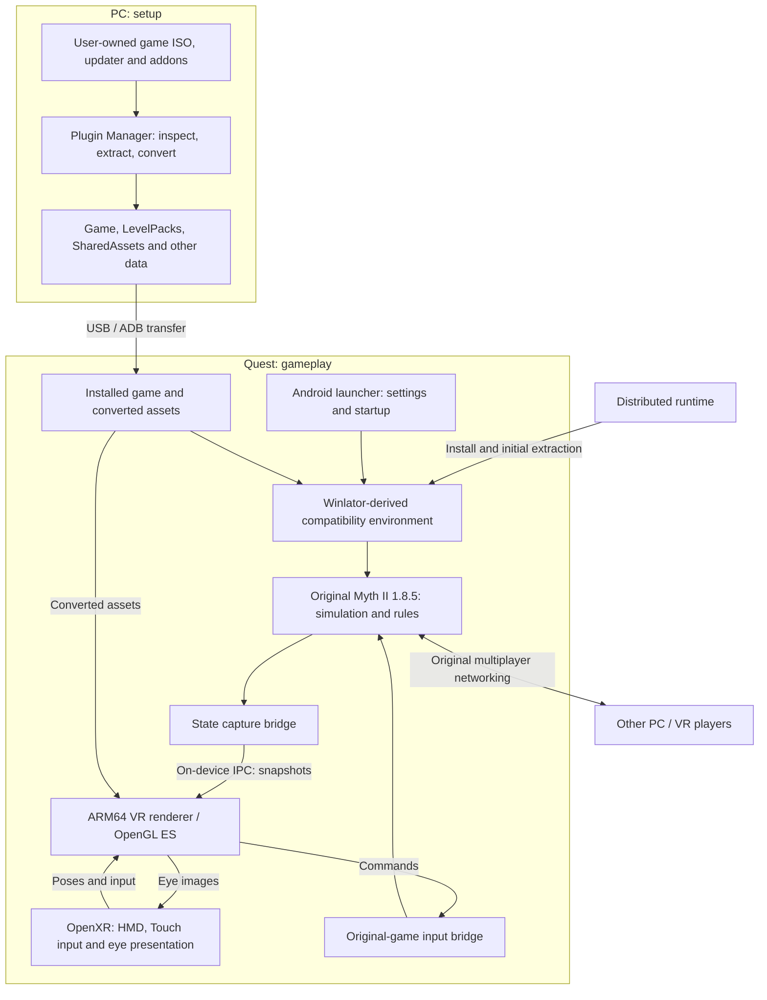

# Technical information

**English** | [日本語](TECHNICAL.ja.md) · [README](../README.md) · [Build guide](BUILD.md)

Implementation baseline: 0.5.0-beta. Notes consolidated on 2026-11-21. These are design and validation records, not performance guarantees for every scene.

[PBR-like rendering and LOD](#pbr-preview)

## How the VR frontend works

The original Myth II 1.8.5 runs on Quest, while a custom VR renderer draws its game state. This is not simply the original video displayed on a flat screen: terrain, models and sprites are rendered from each eye's viewpoint. The original game remains responsible for simulation, unit behavior, rules, progression and its multiplayer processing.

The Windows game uses a Winlator-derived environment, including Wine and Box64. VR rendering uses native Android ARM64 code, OpenXR for HMD/controller tracking and eye presentation, and OpenGL ES for drawing. A PC prepares and installs data; both game execution and VR rendering take place on Quest during play.

On-device bridge communication and multiplayer networking are separate paths.

| Component | Responsibility | Implementation entry points |
| --- | --- | --- |
| PC Manager | Validate user-owned data; prepare and transfer game files and VR assets | [plugin_manager.py](../tools/plugin_manager.py), [base_setup.py](../tools/base_setup.py) |
| Android launcher | Settings, runtime preparation, game startup and level asset preparation | [src/standalone](../src/standalone), [src/standalone185](../src/standalone185) |
| Compatibility environment | Execute the Windows game on Quest | [Build configuration](BUILD.md), [third-party notices](../THIRD_PARTY_NOTICES.md) |
| Capture/input bridges | Capture objects, animation, effects and UI state; return VR commands to the game | [src/bridge](../src/bridge), [src/input](../src/input) |
| VR renderer | Combine assets and live state to render stereo scenes, reflections and UI | [main.cpp](../src/vr/main.cpp), [src/vr](../src/vr) |

State capture uses loopback TCP with a per-install authentication token. Snapshot versions, counts and sizes are validated. Game updates and HMD rendering do not have identical timing; the renderer uses received state and the current viewpoint. Adding VR presentation features does not replace the original simulation.

Original menus and the lobby use a compatibility screen; starting a level transitions to VR. Static assets are converted on PC, while positions, animation frames, palettes and surface changes are updated during play. This project's license does not relicense original game data or third-party plugins.

## Optimization principles

Prefer removing duplicate work, draw submissions and transfers while retaining the result. Resolution reduction and distance LOD are separate quality/performance choices. CPU time, GPU time, FPS, grouped ranges and estimated texture-sampling opportunities are different metrics.

| Area | Implemented technique | Purpose and trade-off |
| --- | --- | --- |
| Sprites | Runtime atlas and material batching | Fewer texture changes and draws; additional GPU memory |
| Stereo | Shared opaque-sprite binocular visibility and uploads | Less CPU work and transfer; GPU clips extra edge geometry per eye |
| Particles | Ordered vertex streams, buffering, frustum culling, vertex opacity | Merge adjacent compatible draws without changing order or opacity |
| Reflections | Stereo caches per plane; ordinary billboard preparation shared across planes | Less frame/geometry preparation; axial projectiles remain plane-specific |
| Water | Spatial tiles, stencil and asynchronous visibility queries | Avoid unnecessary reflection work without waiting for GPU results |
| Terrain | Back-face and per-eye chunk-frustum culling; contiguous range merging | Less invisible geometry work; not general terrain occlusion culling |
| Terrain detail | Compact duplicate material IDs and weights on CPU | Avoid redundant sampling while preserving material transitions |
| Shadows/lights | Distance/size LOD, skipped redundant shadow reads, light influence bounds | Control shader cost; LOD trades quality for speed |
| Color correction | Existing shaders; original shader source when OFF | No extra full-screen pass or histogram analysis |
| Bloom | Low-resolution extraction, separable blur, temporary targets reused across eyes | OFF/zero bypass; full-size capture and composition still cost bandwidth |

## Sprites and atlases

Sources: [sprite_atlas.h](../src/vr/sprite_atlas.h), [sprite_cache.h](../src/vr/sprite_cache.h), [sprite_stream.h](../src/vr/sprite_stream.h).

Current pages are 2048×2048 RGBA8 with two replicated border texels. Color and normal maps have independent layouts; ordinary and HD color images use separate pools. An immutable source normal texture has one shared slot per level. The earlier experiment with normal pages tied to color pages duplicated normals and exhausted capacity, so it was replaced.

The 768 MiB ceiling covers additional atlas storage only, not original textures or eye buffers. Pages allocate on demand. Oversize images or capacity exhaustion fall back to original textures. Normal opaque sprites share the union of both eye frusta and reuse the stream for the second eye. Sorting vertex references followed by one final copy removes intermediate arrays and repeated allocations. Reflections retain eye-specific water bounds.

**Recorded result:** a synthetic Willow Creek fixture registered 4,282 images from 35 collections. Moving from 512px to 2K pages changed 46 pages / 46 ranges / 52 MiB to 4 pages / 4 ranges / 64 MiB, with no fallback. This excludes HD and normal payloads and is not a count of simultaneously visible images or gameplay draws. Larger pages reduce switching but increase allocation granularity and unused space.

Quest GPU comparisons against non-atlas rendering had a maximum channel difference of 1/255. Shared stereo uploads versus independently culled eye uploads were pixel-identical. See [test_sprite_atlas_gpu.cpp](../tools/test_sprite_atlas_gpu.cpp). These checks do not establish an FPS gain.

## Waterfalls, particles and reflections

Sources: [particle_stream.h](../src/vr/particle_stream.h), [water_visibility.h](../src/vr/water_visibility.h).

A Beyond Cloudspine problem capture on 2026-11-20 reached 33 FPS and 99% GPU utilization. Normal effects used about 4.728 CPU ms/frame and reflected effects 4.658, with roughly 280–300 draws per pass. Terrain GPU cost also rose; particles were not the only bottleneck.

Different fade opacities were splitting otherwise compatible batches. Opacity moved to a vertex attribute, retaining primitive order and merging only adjacent ranges with matching texture, owner and resolved material. No opacity quantization or particle reduction is used. The extra stream costs 16 bytes per vertex, or 96 per billboard. Normal/reflected GPU comparisons were pixel-identical.

Reflection preparation averaged 2.269 CPU ms/frame over 19 reporting windows (1.396–2.644). That is the measured work targeted, not time saved. Ordinary billboard frame/HD lookup and geometry preparation are now shared across water planes, while per-plane height clipping and visibility remain. Shared candidates cannot be restricted to the direct view: reflections can show objects absent from it. Axial projectile geometry remains plane-specific.

Water queries consume completed results only. Reflections can take a frame or more to return after water becomes visible. Water-geometry stencil masking and tiled projection bounds also restrict reflection work.

**Gameplay feedback:** the user reported some improvement after particle batching and further modest improvement after shared reflection preparation and terrain culling. No matched viewpoint/settings A/B measurements establish a percentage. Older captures of 7–16 FPS and a later approximately 72 FPS also differ in visible particle count/viewpoint and must not be treated as a direct before/after comparison.

Evidence: [particle opacity batching](../research/reports/particle-alpha-batching.md), [terrain/reflection investigation and implementation follow-up](../research/reports/terrain-reflection-optimization-review.md).

## Terrain and shaders

Sources: [detail_materials.h](../src/vr/detail_materials.h), [detail_terrain.h](../src/vr/detail_terrain.h), [color_pipeline.h](../src/vr/color_pipeline.h).

Normal terrain uses conservative per-eye frustum culling and merges surviving contiguous vertex ranges. Back-face culling accounts for reversed reflection winding. This reduces invisible geometry work, not necessarily visible pixel shading. The investigation's average normal terrain GPU time of 2.933 ms/call is sampled per eye/pass and cannot be added to CPU ms/frame.

Terrain detail interpolates up to three materials per triangle. Repeated IDs and their weights are compacted on CPU; unused slots become zero. Small weights are not discarded, and transitions to material zero are not renormalized. Explicit gradients, mip selection, texture scale and fog are preserved.

| Local Beyond the Cloudspine pack analysis | Result |
| --- | ---: |
| Triangles | 99,458 |
| One distinct positive material ID | 77,737 (78.16%) |
| Two / three distinct IDs | 21,484 / 237 |
| Triangle-weighted sampling opportunities | 298,374 → 121,416 (about 59.3% fewer) |
| Average sampling opportunities | 3 → about 1.221 |

This is static analysis, not weighted by screen area, not measured GPU fetches, and not a 59.3% speedup. Quest validation passed 14,784 CPU interpolation comparisons and 768 production-shader GPU image comparisons, with maximum observed byte difference zero. Gameplay FPS gain remains unmeasured. See the [investigation and implementation record](../research/reports/terrain-shader-optimization-review.md).

Optional detail LOD fades detail at distances 20–40 and skips it beyond 40, preserving base terrain color and shadows but changing appearance. A dedicated fully opaque terrain shader and depth prepass remain investigation candidates, not implemented achievements.

## Lessons from color correction and Bloom

Color correction applies `mix(c, clamp(c * (255 / 199), 0, 1), strength)` to display-encoded color before fog, existing sRGB decoding and added local lighting. Sky/UI are excluded; reflections are corrected once. OFF returns the original shader source. ON adds no full-screen pass, texture fetch or histogram analysis, but actual in-game overhead is unmeasured, so it should not be called free. [Color correction record](../research/reports/scene-color-correction.md).

Bloom captures/resolves the full-resolution eye image before UI, extracts highlights at low resolution, applies horizontal/vertical separable blur and adds the result. Sky-only pixels are excluded as sources. There is no separate reflected Bloom pass; reflected highlights in the eye image may glow. Temporary images are reused sequentially across eyes.

- Default OFF; zero strength also bypasses processing. Resolution is 1/32–1/2 per dimension, iterations 1–4, strength 0–200%; stored defaults are 1/8, one iteration and 15%.
- Low resolution does not remove full-resolution capture/composition. Above zero, increasing strength does not add passes.
- A synthetic 1536×1536 SRGB non-MSAA test recorded 0.503 ms/eye pass at 1/8 with one iteration, and 1.117 at 1/2 with four. These are CPU wall-clock measurements over 12 passes including source painting and glFinish, not isolated game GPU timings.
- The user confirmed 90 FPS in a light scene at minimum scene resolution with 1/8 Bloom. This does not generalize to waterfalls or other settings.
- GPU tests cover all resolution choices, RGBA/SRGB, MSAA on/off, no residual glow between eyes, GL state restoration and no allocation when OFF.

See the [Bloom design/validation record](../research/reports/bloom.md). It retains the historical 400% strength trial; the current maximum is 200%.

## Measurement and future records

Compare one change at a time using the same film/game state, fixed viewpoint, resolution, refresh rate, MSAA, HD assets, shadows, lighting and reflections. Separate first-use atlas registration from warmed-up operation. Record device thermal/power state, measurement duration and build/commit. FPS capped at refresh rate can hide improvements, so also inspect CPU/GPU stages.

| Log | Interpretation |
| --- | --- |
| Particle stages: legacy_draws / draws | Old opacity-sensitive grouping versus actual batching for the same input |
| Sprite stereo: shared_upload_reuses | Reuse across eyes |
| Sprite atlas / atlas-high-water.tsv | Pages, additional memory and fallbacks; range totals are not FPS |
| Reflection geometry: shared_builds / shared_reuses | Geometry preparation shared across planes |
| Terrain view: chunks / draw_calls | Visible chunks and submitted ranges |
| Terrain detail compact | CPU-estimated sampling opportunities, not hardware fetch measurements |
| CPU/GPU stage id=14 | Bloom; distinguish CPU ms/frame from GPU per-eye/pass samples |

For each addition, record: problem/hypothesis → implementation → comparison conditions → numbers and units → visual validation → limitations/next steps. Distinguish user impressions, synthetic tests and controlled A/B measurements. Later implementation follow-ups and current code take precedence over early proposals in research notes.

Design history: [stereo sharing and the unique-normal correction](../research/reports/stereo-stream-paired-atlas.md), [2K pages and capacity trials](../research/reports/atlas-2k-pages.md), [terrain options and early investigation](../research/reports/terrain-options-and-sprite-reuse.md). Historical values such as the 256 MiB budget describe those earlier experiments.

## Packed sprite materials: implementation note (development, 2026-11-21)

The Editor exports `MVRMAT03` (`.mvrnm`), retaining the source SHA-256 identity and existing dimensions/64 MiB limits. Each RGBA8 texel holds normal XY, Thickness, and shared Metallic/Smoothness. Positive normal Z is reconstructed; no separate Thickness sample is needed. Legacy V1/V2 normal packs retain their alpha-validity semantics. V3 overrides legacy data for the same source. HD crop/flip mappings preserve the format flag.

Dynamic atlases copy all four channels and duplicate edge texels. Packed materials and legacy normals use separate page groups; batch keys include the format. Color pages can still be shared. This may allocate an additional 2048² RGBA8 material page (16 MiB) when both formats are present, within the existing atlas budget.

The renderer uses the same surface-to-light vector as shadow generation and the same equirectangular/yaw mapping as the sky renderer. A CPU average of a wrapped/clamped 3×3 source-pixel neighborhood supplies **linear RGB radiance**, retaining both hue and brightness rather than normalizing the sample. Sampling occurs on sky/direction changes, not per pixel or per eye. The decoded RGB sky is retained for resampling after sun adjustment (up to 24 MiB for 4096×2048); it is cleared when replacing the sky or leaving VR. Missing sky data disables the additions.

A Blinn-style highlight uses shared M&S for color response and exponent. Transmission uses `(1 - Thickness) * (1 - M&S)` and backlighting, attenuated by received-shadow visibility in enhanced-shadow mode. It does not reuse self-shadow attenuation, which would erase backlighting. Reflection samples the existing sky texture with an explicit roughness-dependent mip, blended by `M&S * maximumReflection`. This is a low-cost artistic approximation: mipmaps are not a prefiltered BRDF environment, source color includes baked lighting, and no thickness geometry or HDR sun is reconstructed. Fog attenuates the added effects. All three strengths zero compiles out the PBR path; legacy-only material draws bypass it.

Validation on Quest: 32 shadow/light/PBR/atlas/color-correction shader combinations compiled and passed existing alpha/reflection draw checks. Synthetic pixel tests verify specular gain, no transmission at Thickness=1, transmission at Thickness=0, metal suppression of SSS, reflection blend, received-shadow suppression, and unchanged legacy materials. Runtime tests verify source-hash matching, truncated-pack rejection, V3 priority, atlas group separation and gutter channel preservation, plus sky seam/yaw/reset sampling. Python tests cover export and library conversion/restoration, including material channels. **No gameplay FPS improvement or cost measurement is claimed yet.**

Sources: `src/vr/sprite_pbr.h`, `sprite_material.h`, `sprite_atlas.h`, `color_pipeline.h`; `tools/test_scene_shader_variants_gpu.cpp`, `test_sprite_material_pipeline.h`.

The bypass implementation selects separate production shaders per draw batch, with no PBR helper/call/uniforms in the ordinary variant. Material channels are summarized once on texture upload, preserved in atlas bindings and included in batch keys. Common uniforms are prepared lazily once per shader per eye/reflection pass. Particle order is preserved. Tests in `tools/test_sprite_pbr_routing_gpu.cpp` execute the production SpriteStream/ParticleStream and program-switching code on Quest, including mixed formats, atlas on/off, zero strengths, missing sky and alpha blending/reflections.

Launcher sleep diagnostics: `launcher-lifecycle.log` in the app’s external files directory records create/recreate, start/resume, pause/stop, destroy, saved state, window focus and memory warnings with process ID, wall time, uptime and screen-interactive state. It remains available with detailed VR logging OFF and rotates at 128 KiB into one previous file. Compare it with Android process exit history to distinguish process death from a window-resume problem. This is instrumentation, not a confirmed fix for intermittent disappearance after prolonged sleep.

## PBR-like rendering and LOD

MVRMAT05 carries a PBR flag for each image. Flagged RGBA data stores normal X, normal Y, Thickness and packed M1S7. The shader reconstructs positive normal Z. Color alpha retains the sprite silhouette. The atlas preserves material format and per-image UV bounds.

Both regular and reflected draws use the stereo midpoint for distance LOD. At the defaults, SSS, specular and sky reflection fade together between 20 and 24 m in one draw. Entirely distant sprite batches select a non-PBR program. Mixed batches skip the distant PBR contribution per object. With enhanced shadows enabled, eligible distant meshes use face normals and the sun direction for simplified self-shadowing, reducing the brightness jump during transition. Meshes can be excluded from distance LOD independently. Scene-specific FPS gains have not been measured.

## Reflection preparation and culling (Preview 3, 2026-11-24)

Conservative coarse sprite rejection runs before expensive geometry preparation, using the current image/direction and resident HD bounds. Normal and reflected passes share frame-local preparation where valid; axial geometry retains its pass-specific orientation. A frame-local spatial index selects reflection candidates. Shared geometry/atlas preparation covers the union of water planes and eyes, with separate per-pass index buffers. Conservative camera-plane handling and a missing-candidate rebuild fallback fix the film-playback crash encountered during development.

Reflection sprite LOD caches plane/eye transforms and per-sprite distance, selects cropped-water candidates before projection, shares decisions between eyes/passes and exits projection early when retention is already proven. Empty sprite passes skip sprite-program setup; other reflection content still renders. No new terrain geometry LOD is introduced.

Log counters include coarse tests/rejections and preparation reuse, shared reflection geometry, Reflection sprite LOD (tested, near-kept, rejected, empty passes, CPU time), and Reflection LOD work (projected eyes/corners and early keeps). Counts across planes/eyes are not unique world objects or draw-call counts. CPU wall time can include driver waits; it must not be interpreted as pure CPU execution or substituted for GPU timer results.

Quest validation covers selection against brute force, camera-plane regression, 144 coarse/preparation comparisons, 112 shared-render comparisons, stereo LOD/hysteresis/configuration and 28,672 old/new fast-LOD decisions. The final film runs reported no fatal crash or union-repair event. At viewpoint 1, film ticks 600–1300, one run per configuration (23 samples), 32 px reduced selected reflected sprite instances from about 2,317 to 564 per frame; reflection CPU time changed from 9.99 to 9.46 ms/frame and FPS from 51.19 to 52.63. These are scene-specific observations, not general performance guarantees or visual approval of 32 px. The default remains 2 px. Existing terrain and PBR shader LOD remain separate features.
